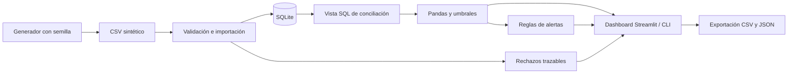

# AssetGuard — Asset Loss Audit System

**Simulación local de auditoría de entradas y salidas de mercancía**, creada como proyecto de portafolio por Giovanny Alvarado Barrantes. Modela un escenario ficticio de distribución o procesamiento de alimentos: compara documentos y movimientos observados, estima el valor de las diferencias y genera alertas explicables.

Todos los datos, proveedores y operaciones son sintéticos. El proyecto no representa un sistema utilizado por Walmart ni por ninguna empresa real. Una discrepancia es un **caso por investigar**, no un robo confirmado ni una pérdida contable demostrada.

Repositorio: [gig0d/asset-loss-audit-system](https://github.com/gig0d/asset-loss-audit-system).

## Funcionalidades implementadas

- Generación reproducible con semilla `42`: 600 operaciones válidas y seis filas inválidas intencionales en CSV.
- Validación de nueve campos, identificadores, fechas, cantidades, precios y catálogos de movimiento e inspección.
- Importación atómica en SQLite, IDs únicos, rechazos con motivo y fila original, e idempotencia por contenido SHA-256.
- Conciliación SQL; clasificación por umbrales configurables y variación de inventario con signo según movimiento.
- Reglas de diferencias excesivas, contenido comercial repetido, IDs duplicados y recurrencia por proveedor.
- Dashboard Streamlit con indicadores, tendencias, comparación de proveedores, inventario, conciliación, alertas y rechazos.
- Filtros de fechas, proveedor, movimiento e inspección; filtros adicionales de regla y severidad en alertas.
- Exportación de resultados, alertas y rechazos desde el dashboard; seis informes CSV y un resumen JSON desde la CLI.
- Pruebas automatizadas de validación, cálculos, reglas, persistencia, exportación, CLI y dashboard.

## Stack y requisitos

Python **3.13** (verificado localmente con **3.13.18**), SQLite incluido en Python, SQL, Pandas **2.3.3**, Streamlit **1.50.0**, Pytest **8.4.2** y Git/GitHub. Las dependencias directas se fijan en `requirements.txt`; las dependencias transitivas se resuelven durante la instalación.

La ejecución no requiere cuentas externas, credenciales, servicios en la nube ni APIs de pago. Solo la instalación inicial de dependencias necesita acceso a Internet. SQLite debe ser 3.37 o posterior por el uso de tablas `STRICT`; las distribuciones habituales de Python 3.13 lo incluyen.

## Instalación y ejecución

### Windows / PowerShell

Con Python 3.13 y Git instalados:

```powershell
git clone https://github.com/gig0d/asset-loss-audit-system.git
cd asset-loss-audit-system
py -3.13 -m venv .venv
.\.venv\Scripts\python.exe -m pip install -r requirements.txt
.\.venv\Scripts\python.exe -m src.cli demo
.\.venv\Scripts\python.exe -m streamlit run app.py
```

Abrir **http://127.0.0.1:8501**. El comando `demo` ya carga la muestra; también se puede iniciar directamente el dashboard y pulsar **Cargar demostración**. No es necesario activar el entorno virtual ni cambiar la política de ejecución de PowerShell. Detener el servidor con `Ctrl+C`.

### Linux / macOS

```bash
git clone https://github.com/gig0d/asset-loss-audit-system.git
cd asset-loss-audit-system
python3.13 -m venv .venv
.venv/bin/python -m pip install -r requirements.txt
.venv/bin/python -m src.cli demo
.venv/bin/python -m streamlit run app.py
```

Los comandos siguientes usan `python` como abreviatura del intérprete del entorno virtual. En PowerShell, se puede sustituir por `.\.venv\Scripts\python.exe`.

## Uso desde la terminal

```bash
# Regenerar exactamente la muestra incluida (600 válidas + 6 inválidas)
python -m src.cli generate --seed 42 --rows 600 --output data/sample/transactions.csv

# Validar e importar sin modificar registros ya existentes
python -m src.cli import data/sample/transactions.csv --db data/assetguard.db

# Conciliar y exportar con los umbrales predeterminados
python -m src.cli audit --db data/assetguard.db --output data/exports

# Ajustar clasificación y reglas de recurrencia
python -m src.cli audit --tolerance 2 --moderate 6 --high 12 --supplier-min 15 --recurrence-min 4 --recurrence-rate 0.25

# Flujo completo con una base dedicada a la demostración
python -m src.cli demo --db data/demo42.db --output data/exports

python -m src.cli --help
```

`demo` regenera el CSV de muestra con semilla 42 e importa su contenido. Conserva cualquier otro lote ya existente en la base elegida: para reproducir los totales de referencia, utilizar una base nueva o una que contenga exclusivamente esta muestra. La ruta predeterminada de SQLite es `data/assetguard.db`; las rutas predeterminadas se resuelven desde la raíz del proyecto.

## Contrato de datos

CSV UTF-8 (BOM opcional), separado por comas, con cabecera y exactamente estas nueve columnas. El orden de columnas puede cambiar; los nombres deben coincidir. Se omiten las líneas completamente vacías según el lector CSV de Python.

| Campo | Regla |
|---|---|
| `fecha` | Fecha válida en formato estricto `YYYY-MM-DD` |
| `transaccion_id` | `TX-` seguido de seis dígitos ASCII; único en toda la base |
| `proveedor` | Texto obligatorio, hasta 120 caracteres, sin caracteres de control |
| `producto` | Texto obligatorio, hasta 120 caracteres, sin caracteres de control |
| `cantidad_facturada` | Entero entre 0 y 1.000.000; unidad común: cajas |
| `cantidad_recibida` | Entero entre 0 y 1.000.000; unidad común: cajas |
| `precio_unitario` | Precio positivo y finito, máximo 1.000.000,00 y hasta dos decimales; USD por caja, punto decimal |
| `tipo_movimiento` | `ENTRADA` o `SALIDA` |
| `estado_inspeccion` | `APROBADA`, `PENDIENTE` o `RECHAZADA` |

Ejemplo válido, tomado de la muestra:

```csv
fecha,transaccion_id,proveedor,producto,cantidad_facturada,cantidad_recibida,precio_unitario,tipo_movimiento,estado_inspeccion
2026-01-01,TX-000001,Frío Norte (ficticio),Vegetales congelados,100,75,18.50,ENTRADA,APROBADA
```

En una **salida**, `cantidad_recibida` es lo recibido por el destino y se toma como cantidad efectivamente despachada en esta simulación. El proveedor actúa como contraparte ficticia de referencia en ambos movimientos; no se modelan clientes por separado. El estado de inspección se conserva como atributo y filtro: una inspección rechazada no excluye automáticamente la operación de la auditoría.

Se recortan espacios exteriores de los campos. La comparación de nombres distingue mayúsculas, minúsculas y acentos. Las cantidades negativas o fraccionarias se rechazan. Una base facturada de cero se permite expresamente para analizar movimientos sin cantidad documentada.

### Rechazos e idempotencia

Cada fila inválida conserva `batch_id`, número de registro CSV (cabecera = 1), ID original, código, motivo y `raw_json`. Se registra la primera causa de rechazo según el orden de validación. Los registros aceptados y rechazados de un archivo se confirman en una sola transacción SQLite; un fallo de base de datos revierte todo el lote.

Un archivo con cabecera incorrecta, codificación inválida, estructura CSV mal formada o sin filas de datos se rechaza completo antes de importar. Sus errores se muestran al usuario; no se crean rechazos por fila para archivos que no pueden interpretarse. Las filas con celdas faltantes o adicionales sí se guardan como rechazos.

- **Mismos bytes, incluso con otro nombre:** se devuelve el lote original sin nuevas transacciones ni rechazos.
- **Contenido diferente con un ID existente:** se crea otro lote y se rechaza esa fila como `ID_DUPLICADO`; no se actualiza la transacción original.
- **Contenido comercial idéntico con IDs distintos:** se conservan ambas operaciones y se genera una alerta para cada una. Puede tratarse de operaciones legítimas; es necesaria la revisión documental.

## Conciliación, clasificación y reglas

```text
diferencia_cantidad = cantidad_recibida - cantidad_facturada
porcentaje_diferencia = abs(diferencia_cantidad) / cantidad_facturada * 100
valor_estimado_centavos = abs(diferencia_cantidad) * precio_centavos
impacto_inventario = diferencia_cantidad * (+1 en ENTRADA; -1 en SALIDA)
```

Precios y valores se almacenan y calculan en **centavos enteros**. Los importes en USD se derivan para presentación; las columnas `*_centavos` son la referencia exacta de los informes. No se compensan faltantes y sobrantes en el valor económico estimado y no se suman valores por alerta, porque una misma operación puede activar varias reglas.

| Clasificación | Umbral predeterminado |
|---|---|
| `SIN_DIFERENCIA` | Diferencia = 0 |
| `TOLERABLE` | 0 < diferencia absoluta porcentual ≤ 1 % |
| `MODERADA` | 1 % < diferencia absoluta porcentual ≤ 5 % |
| `ALTA` | 5 % < diferencia absoluta porcentual ≤ 10 % |
| `CRITICA` | Diferencia absoluta porcentual > 10 %; también base facturada = 0 con recibida > 0 |

Si ambas cantidades son cero, la operación es `SIN_DIFERENCIA`. Si solo la facturada es cero, el porcentaje se deja vacío y la clasificación es crítica. Se valida `0 ≤ tolerancia < límite moderado < límite alto`.

**Discrepancias detectadas** cuenta todas las diferencias no nulas, incluidas las tolerables. **Casos para revisión** cuenta `MODERADA`, `ALTA` y `CRITICA`. **Valor estimado por investigar** incluye todas las diferencias, incluidas las tolerables: no es una estimación de robos ni una cuenta de pérdidas.

| Regla | Condición |
|---|---|
| `DISCREPANCIA_EXCESIVA` | Clasificación `ALTA` o `CRITICA` |
| `TRANSACCION_REPETIDA` | Misma fecha, proveedor, producto, cantidades, precio y movimiento con otro ID; la inspección no forma parte de la clave |
| `ID_DUPLICADO` | Intento de importar un ID existente, guardado en rechazos |
| `PROVEEDOR_RECURRENTE` | Al menos 10 operaciones, al menos 3 casos para revisión y tasa de revisión ≥ 20 % por proveedor |

Los tres criterios de recurrencia son configurables. No se aplica ventana temporal adicional: se usa el período del conjunto auditado. En el dashboard, clasificación, recurrencia y repetición comercial se evalúan sobre los movimientos seleccionados; los intentos de ID duplicado se muestran cuando el ID está en la selección. El historial de rechazos siempre muestra todos los lotes y lo indica expresamente.

El inventario se presenta como **variación de movimientos por producto**, sumando entradas y restando salidas. No se calcula inventario final porque no se conoce el inventario inicial.

## Arquitectura



`import_batches` identifica cada archivo por SHA-256 y registra sus conteos. `transactions` almacena las operaciones aceptadas y referencia su lote. `rejections` conserva las filas rechazadas y su origen. La vista SQL `reconciliation` calcula diferencias y movimientos con signo. La clasificación y las alertas se recalculan desde esos datos cuando cambian los umbrales: no se guardan conclusiones obsoletas como si fueran hechos.

Las consultas de importación usan parámetros SQL, las conexiones activan claves foráneas y se cierran explícitamente. SQLite serializa las escrituras con `BEGIN IMMEDIATE`. Las exportaciones añaden BOM UTF-8 y neutralizan texto que podría interpretarse como una fórmula al abrirlo en una hoja de cálculo.

Consulta de ejemplo sobre la base generada:

```sql
SELECT proveedor, COUNT(*) AS operaciones,
       SUM(valor_estimado_centavos) AS valor_por_investigar_centavos
FROM reconciliation
WHERE diferencia_cantidad <> 0
GROUP BY proveedor
ORDER BY valor_por_investigar_centavos DESC;
```

## Estructura implementada

```text
asset-loss-audit-system/
├── app.py                         # Dashboard Streamlit
├── requirements.txt              # Dependencias directas fijadas
├── pyproject.toml                 # Python 3.13 y configuración de Pytest
├── README.md
├── .gitignore
├── .streamlit/config.toml         # Tema, localhost y telemetría desactivada
├── .github/workflows/tests.yml    # Pruebas en Python 3.13
├── src/
│   ├── __init__.py
│   ├── config.py                  # Rutas y umbrales validados
│   ├── generator.py               # Datos sintéticos reproducibles
│   ├── validation.py              # Contrato y validación por fila
│   ├── schema.sql                 # Tablas, restricciones, índices y vista
│   ├── database.py                # Conexiones e inicialización
│   ├── ingestion.py               # Lotes, rechazos e idempotencia
│   ├── audit.py                   # Conciliación y agregaciones
│   ├── anomalies.py               # Reglas explicables
│   ├── reporting.py               # CSV y resumen JSON
│   └── cli.py                     # generate / import / audit / demo
├── data/sample/
│   ├── transactions.csv           # 606 filas de datos, semilla 42
│   ├── expected_summary.json      # Resultados de una ejecución real
│   └── example_results.csv        # Siete operaciones conciliadas reales de la muestra
├── tests/                         # Suite automatizada
└── docs/screenshots/README.md      # Lista de capturas pendientes
```

`data/assetguard.db`, `data/exports/`, entornos virtuales, herramientas locales y cachés se generan durante la ejecución y están excluidos de Git.

## Resultados obtenidos realmente

Ejecución local del flujo `demo`, con Python 3.13.18, base inicialmente vacía, semilla 42 y configuración predeterminada:

| Resultado | Valor observado |
|---|---:|
| Filas de datos CSV | 606 |
| Operaciones aceptadas y auditadas | 600 |
| Filas rechazadas | 6 |
| Discrepancias no nulas | 188 |
| Casos para revisión | 129 |
| Valor económico estimado por investigar | USD 38.586,75 |
| Alertas por diferencia excesiva | 95 |
| Alertas de operaciones repetidas | 5 |
| Alertas por proveedor recurrente | 2 |
| Alertas de ID duplicado | 1 |
| Total de alertas | 103 |

Clasificaciones observadas: 412 sin diferencia, 59 tolerables, 34 moderadas, 19 altas y 76 críticas. Cada rechazo de la muestra corresponde a una causa distinta: ID duplicado, cantidad negativa, ID inválido, dato incompleto, precio no finito y fecha inexistente.

Ejemplos del informe generado:

| Operación | Movimiento | Facturada / recibida | Diferencia | Impacto inventario | Valor estimado | Clasificación |
|---|---|---:|---:|---:|---:|---|
| `TX-000001` | ENTRADA | 100 / 75 | −25 cajas | −25 cajas | USD 462,50 | CRITICA |
| `TX-000011` | SALIDA | 100 / 75 | −25 cajas | +25 cajas | USD 550,00 | CRITICA |
| `TX-000051` | SALIDA | 0 / 5 | +5 cajas | −5 cajas | USD 110,00 | CRITICA |
| `TX-000052` | SALIDA | 0 / 0 | 0 cajas | 0 cajas | USD 0,00 | SIN_DIFERENCIA |

El signo positivo de la segunda operación significa que salieron 25 cajas menos de las documentadas, según las hipótesis del modelo. No demuestra un sobrante físico real.

La segunda ejecución de `demo` devolvió `already_imported: true`, mantuvo un solo lote, 600 transacciones y seis rechazos, y produjo los mismos totales. El resumen verificable y el SHA-256 del CSV están en [expected_summary.json](data/sample/expected_summary.json); los ejemplos completos están en [example_results.csv](data/sample/example_results.csv).

La CLI crea `resultados.csv`, `alertas.csv`, `rechazos.csv`, `proveedores.csv`, `tendencias.csv`, `inventario.csv` y `resumen.json` en el directorio elegido. Las descargas del dashboard respetan la selección visible; la descarga de rechazos abarca el historial completo.

## Pruebas y verificación

```powershell
.\.venv\Scripts\python.exe -m pytest -q
```

**Resultado local comprobado: 83 pruebas superadas, 0 fallidas**, con Python 3.13.18. Incluye límites inclusivos de clasificación, base cero, precios exactos de 0,29, signo en salidas, mínimos y tasa de recurrencia, rechazos, rollback, idempotencia, exportaciones, correspondencia entre datos y resultados versionados, y dos pruebas de interfaz con `streamlit.testing.v1.AppTest`.

En el entorno restringido de desarrollo, la carpeta temporal predeterminada de Windows no era accesible. La ejecución completa se verificó con `python -m pytest -q --basetemp=.tools/pytest-final`. En un entorno con esa misma restricción se puede usar otra carpeta temporal nueva dentro del proyecto. Pytest administra y puede limpiar el directorio indicado: no apuntar a carpetas con datos que se deseen conservar.

El flujo de GitHub Actions está incluido para ejecutar la suite en Python 3.13 con cada push o pull request. Los resultados locales aquí documentados no afirman que una ejecución remota de Actions haya terminado.

También se comprobó el arranque real del servidor Streamlit en localhost: `/_stcore/health` respondió **HTTP 200 / ok**. `pip check` no detectó dependencias incompatibles.

## Capturas pendientes

Pendientes de capturar desde el dashboard real: resumen, alertas filtradas e historial de rechazos. Se listan en [docs/screenshots/README.md](docs/screenshots/README.md). No se incluyen capturas inventadas. AppTest verifica comportamiento de interfaz, pero no sustituye una revisión visual en navegador.

## Limitaciones conocidas

- MVP educativo local, sin autenticación, perfiles de usuario, cifrado de la base, gestión de casos ni despliegue productivo. El servidor escucha en `127.0.0.1` de forma predeterminada.
- Solo cajas enteras y USD sintéticos; no hay kilogramos fraccionarios, conversiones de unidad, impuestos ni múltiples monedas.
- Sin inventario inicial, conteos físicos, lotes de alimentos, caducidades, cadena de frío o evidencia documental real. No determina la causa de una diferencia.
- Reglas deterministas configurables; no hay aprendizaje automático, inferencia de intención ni confirmación de robo. Los umbrales de muestra no son recomendaciones operativas para una empresa real.
- Las repeticiones comerciales se comparan por igualdad exacta y fecha, y pueden corresponder a operaciones legítimas. No se detecta similitud aproximada ni nombres equivalentes.
- Un ID corregido con contenido nuevo se rechaza si ya existe; no se implementaron edición, borrado, reversión de lotes ni conciliación con ERP.
- La vista y las alertas se recalculan; no hay historial versionado de decisiones ni de umbrales. Las exportaciones CLI sí registran la configuración utilizada en `resumen.json`.
- CSV y consultas se cargan en memoria con Pandas. El dashboard limita las cargas a 20 MB y el generador a 100.000 operaciones válidas; no se ha realizado una prueba de carga ni se afirma capacidad de procesamiento masivo.
- SQLite es adecuado para esta demostración local; no se ha validado operación multiusuario intensiva, recuperación ante desastres ni migraciones de esquema.
- Las capturas visuales están pendientes. Las funcionalidades obligatorias del MVP están implementadas; no se presenta como sistema certificado o listo para producción.
